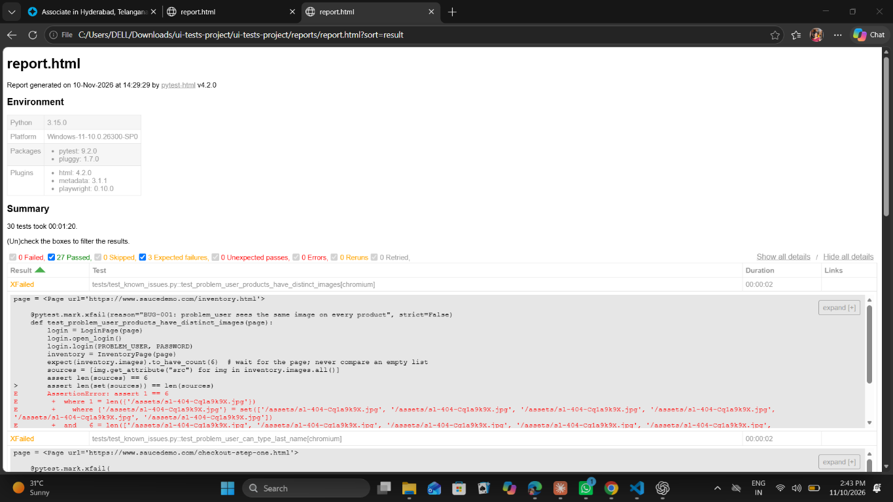

# SauceDemo Web UI Test Automation (Python + Playwright)

UI test automation framework for the [SauceDemo](https://www.saucedemo.com) practice e-commerce site, built with **Python, Playwright, pytest and GitHub Actions** using the Page Object Model.

## What it covers

| Area | Details |
|---|---|
| Login | Valid login, bad credentials, empty fields, locked-out user, direct URL access without login, logout |
| Products | Item count, sort by name and price (A-Z, Z-A, low-high, high-low), name/price/image present |
| Cart | Add, add multiple, remove (from inventory and cart pages), continue shopping |
| Checkout | End-to-end order, form validation (first name, last name, postal code), total = subtotal + tax, cancel |
| Known issues | Intentionally broken demo users (`problem_user`, `performance_glitch_user`) documented with xfail tests and bug reports |
| Performance | Locust load script for the Restful-Booker API (`performance/`) |
| CI | GitHub Actions: smoke job first, then full regression; HTML report, screenshots and traces uploaded as artifacts |

## Design

- **Page Object Model** (`pages/`): one class per page (`LoginPage`, `InventoryPage`, `CartPage`, `CheckoutPage`) so locators live in one place.
- **Fixtures** (`tests/conftest.py`): `inventory` logs in and lands on the products page; page objects are injected into tests.
- **Stable locators**: `data-test` attributes instead of CSS classes.
- **Markers**: `smoke`, `regression`, `negative`, `known_issue`.
- **Evidence on failure**: screenshots and Playwright traces (`test-results/`), plus a self-contained HTML report (`reports/report.html`).

## Project structure

```
pages/        base_page, login_page, inventory_page, cart_page, checkout_page
tests/        conftest, test_login, test_inventory, test_cart, test_checkout, test_known_issues
utils/        helpers (price parsing, ids)
performance/  locustfile.py
docs/         test-plan.md
bug-reports/  BUG-001 .. BUG-003
.github/workflows/ui-tests.yml
```

## Run locally

Prerequisite: Python 3.9+.

```bash
python -m venv .venv
source .venv/bin/activate          # Windows: .venv\Scripts\activate
pip install -r requirements.txt
playwright install chromium

pytest                             # everything
pytest -m smoke                    # smoke only
pytest -m negative                 # negative tests only
pytest -m "not known_issue"        # skip the documented-defect tests
pytest --headed --slowmo 300       # watch the browser
```

The HTML report is written to `reports/report.html`.

### Performance (optional)

```bash
pip install -r requirements-perf.txt
locust -f performance/locustfile.py --headless -u 10 -r 2 -t 1m --csv=reports/locust
```

Keep the load small; the target is a shared public practice API.

## Known issues

The `problem_user` and `performance_glitch_user` accounts are broken on purpose. Tests for them in `tests/test_known_issues.py` assert the correct behaviour and are marked `xfail`. Write-ups are in [`bug-reports/`](bug-reports/).

## Test execution report

| Metric | Result |
|---|---|
| Total tests | 30 |
| Passed | 27 |
| Expected failures (documented bugs) | 3 |
| Unexpected failures | 0 |
| Execution time | about 1 minute |



The 3 expected failures are the documented defects in `bug-reports/`.

### Report screenshots

- [Pytest report overview — inventory failure](screenshots/pytest-report-overview-inventory-failure.png)
- [Duplicate product images failure](screenshots/pytest-report-duplicate-product-images-failure.png)
- [Checkout and login performance failures](screenshots/pytest-report-checkout-and-login-performance-failures.png)
- [Passing tests and performance failure](screenshots/pytest-report-passing-tests-and-performance-failure.png)

